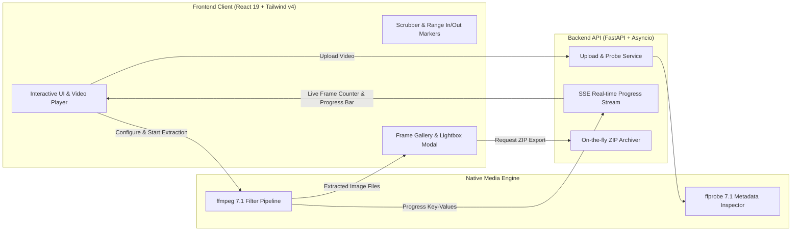

# FrameFlow 🎬

> High-precision video frame extraction application with interactive timeline scrubbing, smart scene detection, and one-click ZIP packaging. Available both as a standalone Windows desktop application (`.exe`) and as a web service.

---

## ⚡ Quick Start Options

Choose how you want to run FrameFlow:

### Option 1: Standalone Windows Desktop App (`.exe`) — *Recommended for local use*
No Python, Node.js, or FFmpeg installation required. All dependencies and FFmpeg 7.1 binaries are bundled.

- **One-Click Launch**: Double-click [`Launch-FrameFlow.bat`](file:///e:/Saas%20Apps/VideoExtractor/Launch-FrameFlow.bat) in the project root.
- **Direct Executable**: Run [`dist/FrameFlow/FrameFlow.exe`](file:///e:/Saas%20Apps/VideoExtractor/dist/FrameFlow/FrameFlow.exe).

> [!NOTE]
> The desktop application runs in a native Edge Chromium WebView2 window with seamless hardware acceleration and zero console flicker.

---

### Option 2: Unified Python Server (Web Browser)
Runs the FastAPI backend and serves the compiled React frontend at `http://localhost:8000`:

```powershell
.\venv\Scripts\python run.py
```
Then visit: **[http://localhost:8000](http://localhost:8000)**

---

### Option 3: Full Development Mode (Hot Reloading)
For developing and modifying frontend components or API routes:

```powershell
# Terminal 1: Backend with auto-reload
.\venv\Scripts\python -m uvicorn backend.main:app --host 127.0.0.1 --port 8000 --reload

# Terminal 2: Frontend with Vite HMR
cd frontend
npm run dev
```
Then visit: **[http://localhost:5173](http://localhost:5173)** (API requests are automatically proxied to port 8000).

---

## 🌟 Key Features

### 1. Smart Extraction Modes
- ⏱️ **Time Interval**: Extract one frame every $X$ seconds (presets: 0.25s, 0.5s, 1.0s, 2.0s, 5.0s, or custom slider).
- 🎞️ **Frame Step / Target FPS**: Extract every $N^{\text{th}}$ frame or downsample to a specific target framerate.
- ⚡ **Scene Change Detection**: Automatically detect cuts and camera switches using FFmpeg's scene sensitivity filter (`gt(scene, threshold)`).
- 🔑 **Keyframes (I-Frames)**: Extract only native intra-coded keyframes (maximum speed, zero generational decoding loss).
- ✂️ **Trim Range**: Extract frames exclusively between custom start and end points chosen on the interactive timeline.

### 2. Interactive Video Player & Scrubber
- **Sub-Second Scrubber**: Live timestamp overlay (`HH:MM:SS.mmm`) synchronized with video playback.
- **Micro-Stepping**: Step forward/backward by single frames (`+1f` / `-1f`) or by seconds (`+1s` / `-1s`).
- **Interactive Range Markers**: Click **`[A] Set Start`** and **`[B] Set End`** at the current playhead position.
- **Speed Multiplier**: Toggle between 0.5x, 1x, and 2x playback speed.
- **Stream Metadata**: Real-time display of container codec, resolution, native FPS, estimated total frames, and file size.

### 3. Quality & Output Format Customization
- **Image Formats**: **JPEG**, **PNG (lossless)**, and **WebP**.
- **Quality Control**: Compression slider (40%–100%) for JPEG and WebP.
- **Resolution Scaling**: Export at original resolution, or downscale to 1080p, 720p, or 480p.

### 4. Frame Gallery & Batch Export
- **Responsive Thumbnail Grid**: Dynamic card grid with timestamp badges and frame indices.
- **Multi-Select Toolbar**: Check individual frames, click "Select All", or invert selection.
- **Fullscreen Lightbox**: Zoomable modal with Left/Right arrow key navigation and individual image download.
- **1-Click ZIP Packaging**: Instantly bundle all or selected frames into a `.zip` archive on the fly.

---

## 🏗️ Architecture & Tech Stack



| Component | Technology | Description |
| :--- | :--- | :--- |
| **Backend API** | Python 3.13 / FastAPI | Asynchronous REST API, SSE streaming, HTTP Range video streaming |
| **Desktop Wrapper**| pywebview / Edge Chromium WebView2 | Native Windows GUI window with safe stream redirection |
| **Frontend UI** | React 19 / Vite / TypeScript | High-performance interactive UI with sub-second player controls |
| **Styling** | Tailwind CSS v4 | Dark mode UI with custom scrollbars and Lucide icons |
| **Video Engine** | FFmpeg 7.1 & FFprobe | Standalone portable binaries bundled with the distribution |

---

## 📁 Project Directory Structure

```
VideoExtractor/
├── Launch-FrameFlow.bat     # 1-click desktop app launcher
├── run.py                  # Single-command Python web server
├── verify_app.py           # Automated test & verification suite
├── FrameFlow.spec          # PyInstaller packaging configuration
├── sample_test.mp4         # Synthetic test video with embedded timecode
│
├── backend/
│   ├── main.py             # FastAPI entrypoint, routes, and static file serving
│   ├── models.py           # Pydantic data schemas (requests, responses, metadata)
│   ├── services/
│   │   └── ffmpeg_service.py # FFmpeg/FFprobe subprocess runner & ZIP packaging
│   ├── bin/                # Bundled standalone ffmpeg.exe & ffprobe.exe
│   └── data/               # Working uploads and extracted task frames
│
├── frontend/
│   ├── index.html          # HTML5 entrypoint
│   ├── vite.config.ts      # Vite configuration & API proxy
│   └── src/
│       ├── App.tsx         # Root application state & workflow coordinator
│       ├── types.ts        # TypeScript interfaces
│       ├── components/
│       │   ├── Navbar.tsx
│       │   ├── UploadDropzone.tsx
│       │   ├── VideoPlayerScrubber.tsx
│       │   ├── ExtractionSettings.tsx
│       │   ├── ProgressBar.tsx
│       │   └── FrameGallery.tsx
│       └── style.css       # Tailwind CSS styles
│
└── dist/
    └── FrameFlow/
        ├── FrameFlow.exe   # Standalone Windows executable
        └── _internal/      # Bundled runtimes, FFmpeg binaries, and frontend dist
```

---

## 🛠️ Verification & Rebuilding

### Run Automated Test Suite
To verify video probing, all extraction modes, image serving, and ZIP creation:

```powershell
.\venv\Scripts\python verify_app.py
```

### Recompile the Standalone `.exe`
Whenever you make updates to the frontend or backend code:

```powershell
# 1. Build the production React client
cd frontend && npm run build && cd ..

# 2. Package into the desktop distribution
.\venv\Scripts\pyinstaller FrameFlow.spec --noconfirm
```
The newly compiled standalone application will be ready in `dist/FrameFlow/FrameFlow.exe`.

---

## 📂 Storage & Log Locations

- **Desktop App Logs**: `%LOCALAPPDATA%\FrameFlow\app.log`
- **Extracted Frames (Standalone mode)**: `%LOCALAPPDATA%\FrameFlow\data\tasks\`
- **Extracted Frames (Python source mode)**: `backend/data/tasks/`
